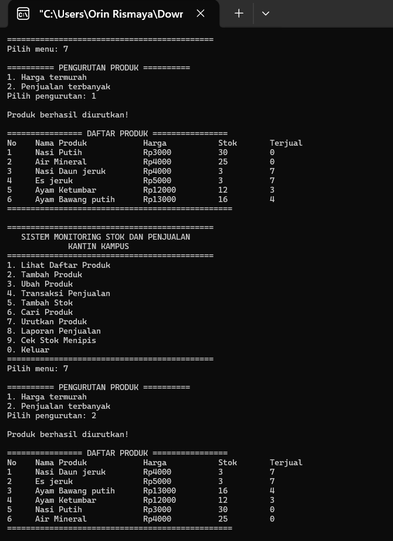

# PROYEK ARRAY C
## Sistem Monitoring Stok dan Penjualan Kantin Kampus

### IDENTITAS MAHASISWA

| Keterangan | Identitas |
|---|---|
| Nama | Orin Rismaya |
| NIM | C2583207046 |
| Kelas | PTI3A |
| Program Studi | Pendidikan Teknologi Informasi |
| Fakultas | Keguruan dan Ilmu Pendidikan |
| Mata Kuliah | Algoritma dan Pemrograman Lanjutan |
| Dosen Pengampu | Taofik Muhammad, M.Kom. |
| Universitas | Universitas Muhammadiyah Tasikmalaya |
| Tahun Akademik | 2026/2027 |

---

# TUGAS 1. IMPLEMENTASI ARRAY

Program Sistem Monitoring Stok dan Penjualan Kantin Kampus dibuat menggunakan bahasa pemrograman C dengan array sebagai struktur data utama.

Array digunakan untuk menyimpan dan mengelola informasi produk. Program memiliki kapasitas maksimal 50 produk dan menyediakan minimal 5 data produk awal.

### Jenis Array yang Digunakan

| Jenis Array | Kegunaan |
|---|---|
| Array 2 dimensi `char` | Menyimpan nama produk |
| Array 1 dimensi `int` atau `float` | Menyimpan harga produk |
| Array 1 dimensi `int` | Menyimpan jumlah stok produk |
| Array 1 dimensi `int` | Menyimpan jumlah produk terjual |

### Penjelasan

Setiap produk memiliki indeks yang sama pada seluruh array sehingga nama, harga, stok, dan jumlah terjual tetap saling terhubung. Program juga menggunakan variabel penghitung jumlah data aktif untuk mengelola penambahan produk baru hingga kapasitas maksimal terpenuhi.

---

# TUGAS 2. IMPLEMENTASI FITUR PROGRAM

Program memiliki beberapa fitur utama untuk membantu pengelolaan stok dan transaksi penjualan kantin.

### Daftar Fitur

| No. | Fitur | Keterangan |
|---|---|---|
| 1 | Lihat Daftar Produk | Menampilkan nama, harga, dan stok seluruh produk. |
| 2 | Tambah Produk | Menambahkan produk baru ke dalam daftar. |
| 3 | Ubah Produk | Mengubah harga dan stok produk. |
| 4 | Transaksi Penjualan | Melakukan pembelian beberapa jenis produk dalam satu transaksi. |
| 5 | Tambah Stok | Menambahkan jumlah persediaan produk. |
| 6 | Cari Produk | Mencari produk berdasarkan nama. |
| 7 | Urutkan Produk | Mengurutkan harga dari termurah dan jumlah terjual dari tertinggi. |
| 8 | Laporan Penjualan | Menampilkan jumlah produk terjual, total pendapatan, dan produk terlaris. |
| 9 | Cek Stok Menipis | Menampilkan produk yang memiliki stok kurang dari 5. |
| 0 | Keluar | Mengakhiri program. |

### Penjelasan

Setiap fitur dibuat untuk membantu pengguna mengelola data produk, memperbarui persediaan, melakukan transaksi, serta melihat hasil penjualan. Seluruh fitur diakses melalui menu utama program.

---

# TUGAS 3. IMPLEMENTASI ALGORITMA DAN PERHITUNGAN

Fitur transaksi penjualan menggunakan algoritma untuk menghitung pembelian dan memperbarui data stok secara otomatis.

### Alur Transaksi

1. Pengguna memilih menu transaksi penjualan.
2. Program menampilkan daftar produk.
3. Pengguna memilih produk yang akan dibeli.
4. Pengguna memasukkan jumlah pembelian.
5. Program memeriksa ketersediaan stok.
6. Jika stok mencukupi, program menghitung subtotal.
7. Program menghitung total pembayaran seluruh produk.
8. Stok produk dikurangi sesuai jumlah pembelian.
9. Jumlah produk terjual diperbarui.

### Rumus Perhitungan

**Subtotal:**

`Subtotal = Harga Produk × Jumlah Pembelian`

**Total Pembayaran:**

`Total = Subtotal Produk 1 + Subtotal Produk 2 + ...`

### Ketentuan Transaksi

- Pembelian dapat terdiri dari beberapa jenis produk.
- Jumlah pembelian harus lebih dari nol.
- Transaksi ditolak apabila jumlah pembelian melebihi stok.
- Stok hanya dikurangi apabila transaksi berhasil.
- Jumlah produk terjual diperbarui setelah transaksi berhasil.

### Laporan Penjualan

Program menghitung:
- Total seluruh unit produk yang terjual.
- Total pendapatan dari transaksi.
- Produk dengan jumlah penjualan tertinggi.

---

# TUGAS 4. VALIDASI INPUT DAN PENANGANAN KESALAHAN

Program dilengkapi validasi untuk mencegah kesalahan input dan menjaga agar data produk tetap sesuai.

### Daftar Validasi

| No. | Kondisi | Penanganan Program |
|---|---|---|
| 1 | Pilihan menu tidak tersedia | Menampilkan pesan pilihan tidak valid. |
| 2 | Produk tidak ditemukan | Menampilkan pesan bahwa produk tidak ditemukan. |
| 3 | Jumlah pembelian nol atau negatif | Menolak input jumlah pembelian. |
| 4 | Harga atau stok negatif | Menolak nilai yang tidak valid. |
| 5 | Pembelian melebihi stok | Menolak transaksi dan mempertahankan stok. |
| 6 | Kapasitas produk mencapai 50 | Menolak penambahan produk baru. |

### Penjelasan

Validasi dilakukan sebelum program memproses data. Dengan demikian, kesalahan input dapat ditangani dan tidak menyebabkan perubahan data yang tidak sesuai.

---

# TUGAS 5. STRUKTUR DAN KETERBACAAN KODE

Program disusun menggunakan fungsi-fungsi terpisah agar kode lebih terstruktur, mudah dipahami, dan mudah dikembangkan.

### Penerapan Struktur Program

| Komponen | Kegunaan |
|---|---|
| Fungsi menu utama | Menampilkan pilihan menu program. |
| Fungsi daftar produk | Menampilkan seluruh data produk. |
| Fungsi tambah produk | Memasukkan produk baru. |
| Fungsi ubah produk | Memperbarui harga dan stok. |
| Fungsi transaksi | Memproses pembelian produk. |
| Fungsi tambah stok | Menambahkan persediaan produk. |
| Fungsi pencarian | Mencari produk berdasarkan nama. |
| Fungsi pengurutan | Mengurutkan data produk. |
| Fungsi laporan | Menampilkan hasil penjualan. |
| Fungsi cek stok | Menampilkan produk dengan stok menipis. |

### Konsep Pemrograman yang Digunakan

- Array untuk menyimpan data produk.
- Percabangan (`if`, `else`, dan `switch`).
- Perulangan (`for`, `while`, atau `do-while`).
- Fungsi untuk memisahkan proses program.
- Searching untuk mencari data produk.
- Sorting untuk mengurutkan data produk.
- Validasi untuk memeriksa input pengguna.

---

# TUGAS 6. PENGUJIAN DAN DOKUMENTASI PROGRAM

Pengujian dilakukan untuk memastikan seluruh fitur program berjalan sesuai dengan ketentuan. Setiap pengujian dilengkapi screenshot dan penjelasan singkat mengenai hubungan antara input, proses, dan output.

### Tabel Pengujian Program

| No. | Skenario Pengujian | Input / Aksi | Hasil yang Diharapkan | Bukti |
|---|---|---|---|---|
| 1 | Tambah produk | Masukkan produk baru | Produk muncul dalam daftar | Screenshot |
| 2 | Transaksi | Beli beberapa produk | Subtotal dan total benar | Screenshot |
| 3 | Pembaruan stok | Selesaikan transaksi | Stok dan jumlah terjual berubah | Screenshot |
| 4 | Stok tidak cukup | Beli melebihi stok | Transaksi ditolak; stok tetap | Screenshot |
| 5 | Laporan | Tampilkan laporan | Unit, pendapatan, dan terlaris benar | Screenshot |
| 6 | Pengurutan | Urutkan harga dan penjualan | Urutan sesuai ketentuan | Screenshot |
| 7 | Pencarian dan stok | Cari produk; cek stok | Hasil dan peringatan tepat |  |

### Dokumentasi Hasil Pengujian

#### 1. Pengujian Tambah Produk

**Penjelasan:** Pengujian dilakukan dengan memasukkan data produk baru. Program diharapkan menyimpan data tersebut dan menampilkannya pada daftar produk.


#### 2. Pengujian Transaksi

**Penjelasan:** Pengujian dilakukan dengan membeli beberapa jenis produk dalam satu transaksi. Program diharapkan menghitung subtotal setiap produk dan total pembayaran dengan benar.


#### 3. Pengujian Pembaruan Stok

**Penjelasan:** Pengujian dilakukan setelah transaksi berhasil. Program diharapkan mengurangi stok sesuai jumlah pembelian dan memperbarui jumlah produk terjual.


#### 4. Pengujian Stok Tidak Cukup

**Penjelasan:** Pengujian dilakukan dengan memasukkan jumlah pembelian yang melebihi stok tersedia. Program diharapkan menolak transaksi dan mempertahankan jumlah stok sebelumnya.


#### 5. Pengujian Laporan Penjualan

**Penjelasan:** Pengujian dilakukan dengan membuka menu laporan penjualan. Program diharapkan menampilkan total unit terjual, total pendapatan, dan produk terlaris berdasarkan jumlah penjualan.


#### 6. Pengujian Pengurutan

**Penjelasan:** Pengujian dilakukan dengan mengurutkan produk berdasarkan harga dari termurah hingga termahal dan berdasarkan jumlah terjual dari tertinggi hingga terendah.


#### 7. Pengujian Pencarian dan Stok

**Penjelasan:** Pengujian dilakukan dengan mencari produk berdasarkan nama dan memeriksa produk yang memiliki stok kurang dari 5. Program diharapkan menampilkan hasil pencarian serta peringatan stok menipis secara tepat.


---

## STRUKTUR FILE REPOSITORY

```text
Proyek-Array-C-NIM/
│
├── main.c
├── README.md
│
└── screenshots/
    ├── 01-tambah-produk.png
    ├── 02-transaksi.png
    ├── 03-pembaruan-stok.png
    ├── 04-stok-tidak-cukup.png
    ├── 05-laporan-penjualan.png
    ├── 06-pengurutan.png
    └── 07-pencarian-cek-stok.png
```

*Catatan: Sesuaikan nama file gambar dengan screenshot yang benar-benar diunggah ke repository.*

---

## KESIMPULAN

Program Sistem Monitoring Stok dan Penjualan Kantin Kampus dirancang untuk mengelola data produk, persediaan, transaksi penjualan, pencarian, pengurutan, dan laporan penjualan menggunakan bahasa pemrograman C.

Penerapan array, percabangan, perulangan, fungsi, searching, sorting, dan validasi input menjadi bagian utama dalam pengembangan program. Pengujian dilakukan untuk memastikan setiap fitur dapat berjalan sesuai dengan ketentuan tugas.
